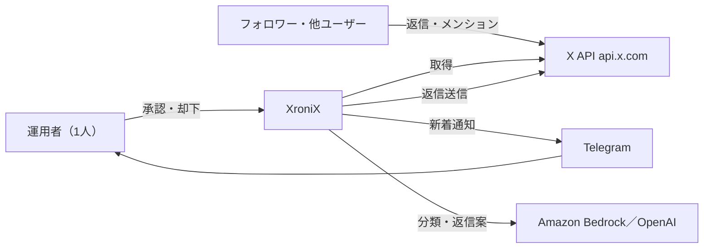

# コンテキストと範囲

## ビジネスコンテキスト

## 外部インターフェース

| 相手 | 方向 | 内容 |
| --- | --- | --- |
| X API | 取得 | `GET /2/users/me`、`GET /2/users/:id/mentions`（since_id、max_results最大100） |
| X API | 取得 | `GET /2/users/:id/tweets`（自投稿の数値）、`GET /2/tweets`（スレッドの文脈） |
| X API | 送信 | `POST /2/tweets`（`reply.in_reply_to_tweet_id`）、`POST /2/users/:id/likes`（いいね。権限 `like.write`） |
| X API | 認可 | `https://x.com/i/oauth2/authorize`、`https://api.x.com/2/oauth2/token` |
| 通知先 | 送信 | 新着と承認待ちの知らせ。内容は最小限にし、本文は承認画面で見る |

## X API の料金（従量課金。docs.x.com で確認済みの値）

| 操作 | 単価 |
| --- | --- |
| 自分の投稿・メンションの読み取り | $0.001／件 |
| 他人の投稿の読み取り | $0.005／件 |
| ユーザー情報 | $0.01／件 |
| 投稿作成 | $0.015／回 |
| リンク付き投稿作成 | $0.20／回 |

- 返信の料金区分はページに明記が無く不明。投稿作成と同額と仮置きし、実測で確認する。
- 月の読み取り上限は300万件。コンソールで月の上限額を設定できる。設定を推奨する。
- 要確認: 取得時に `expansions=author_id` でユーザー情報を展開すると、ユーザー情報として課金される可能性がある。ユニーク31人でも $0.31 だが、実測で確認し、不要なら展開しない。

## 範囲

| 範囲内（MVP） | 範囲外 |
| --- | --- |
| メンション取得、分類、返信案、承認画面、送信 | 自動送信 |
| 日次上限、ブロック対象一覧、緊急停止 | リーチ監視（MVP後） |
| | 自分の投稿への返信への優先表示（MVP後） |
