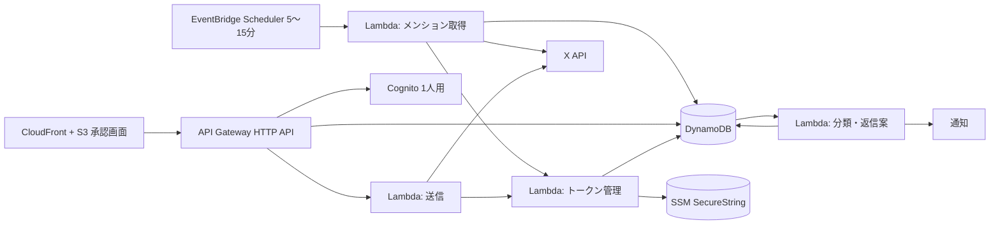

# ブロックビュー

## 全体

## 構成要素

| 要素 | 責務 |
| --- | --- |
| メンション取得 | `since_id` 以降のメンションを取得し、DynamoDBに保存。最新IDを更新 |
| 分類 | スパム／質問／ポジティブ反応／要注意／その他に分類する（ルール、またはAI） |
| ルール・アクション | 反応の種類（返信・引用・メンション・自投稿の数値）と分類に合うルールを探し、いいね、AIの返信案、承認なしの送信、通知などを実行する（ADR-0014） |
| トークン管理 | アクセストークンの取得と更新を1か所に集約。リース用の条件付き書き込みで排他 |
| 承認画面 | 承認待ち一覧、編集、承認、却下、緊急停止。日本語、ⓘで説明 |
| API | 承認画面用。Cognitoで認証 |
| 送信 | 承認済みのみ送信。上限、ブロック、リンク、緊急停止を検査して `POST /2/tweets` |

## DynamoDB の論理項目（案）

| 項目 | 内容 |
| --- | --- |
| メンション | tweet_id、author_id、本文、作成日時、会話ID、分類、状態 |
| 返信案 | 対象tweet_id、候補文、選択文、状態（pending／approved／sending／sent／unknown／rejected） |
| カーソル | 最新の since_id |
| トークンのリース | 更新中フラグ、期限、バージョン |
| 日次カウンタ | 日付ごとの送信数 |
| 設定 | 緊急停止フラグ、日次上限 |
| ブロック対象 | 返信しないユーザーID |

テーブル設計（単一テーブルか複数か）は実装前に別途決める。
