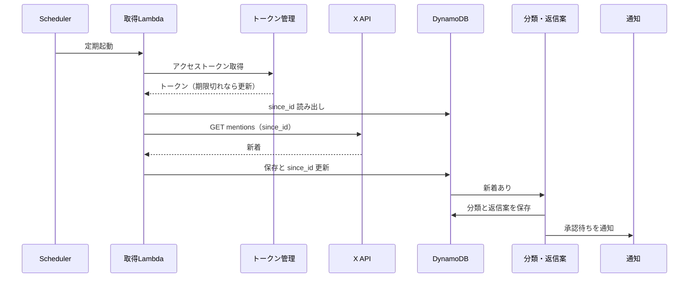
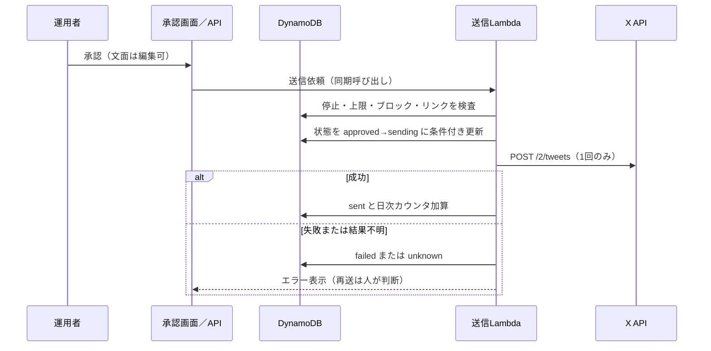

# 実行時ビュー

## 取得から通知まで

- 読み取りは429／5xxで指数バックオフする。503は時々出る。
- 初回起動は過去分を遡るか、現在地点から始めるかを決める（TODO）。

## 承認から送信まで

## トークン更新

- 期限が近い場合のみ更新する。
- DynamoDBでリースを取れた呼び出しだけがリフレッシュを実行する。
- 取れなかった呼び出しは短く待ち、更新後のトークンを読み直す。
- 新しい一対を保存してからリースを解放する。保存に失敗した場合は、再認可が必要になりうる（運用手順に記載する）。
