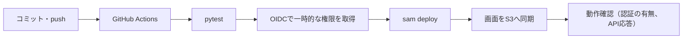

# 検証環境（AWS）のセットアップ手順

mainへのpushで、テスト、デプロイ、動作確認まで自動で行う。この手順は最初に1回だけ必要になる。



## 費用の見込み（月額、推測を含む概算）

| 項目 | 見込み | 根拠 |
| --- | --- | --- |
| Lambda | $0 | 無料枠内。定期処理は月約2,900回、各1秒未満 |
| API Gateway（HTTP API） | $0.01未満 | 100万リクエストあたり約$1 |
| DynamoDB（オンデマンド） | $0.01未満 | 読み書きは月数千回 |
| CloudFront、CloudFront Function | $0 | 無料枠内（転送1TB、リクエスト1,000万、Function 200万回） |
| S3 | $0.01未満 | 画面ファイルは数十KB |
| CloudWatch Logs | $0.1未満 | 保持14日 |
| SSM パラメータ（標準）、EventBridge Scheduler | $0 | 無料 |
| 固定費のあるもの | なし | NAT Gateway、WAF、独自ドメイン（Route 53）、KMSの独自キーは使わない |

AWSの合計は月$0〜1程度。X APIの費用（月約$1〜2）は別である。無料枠が無いアカウントでも、上の表の「$0」は数セント以内に収まる見込みである。

## 手順

### AWS側（1回だけ、約10分）

1. AWSコンソールで東京リージョン（ap-northeast-1）を選ぶ。
2. CloudFormation → スタックの作成 → 新しいリソースを使用 → テンプレートファイルのアップロードで `infra/bootstrap.yaml` を選ぶ。
3. スタック名は `xronix-bootstrap`。パラメータ `GitHubSubject`（OIDCトークンの sub のうち環境名より前の部分）は必須。形式は、下の「注意」を参照。他は既定のままでよい。
   - このアカウントに GitHub の OIDC プロバイダーが既にある場合だけ、`CreateOidcProvider` を `false` にする。
4. 「IAMリソースを作成する場合があることを承認」にチェックして作成する。
5. 出力タブの `RoleArn` と `ArtifactBucket` を控える。

### GitHub側（1回だけ）

1. リポジトリの Settings → Environments → New environment で `staging` を作る。
2. Environment variables に次を登録する。
   - `AWS_ROLE_ARN`: 上の `RoleArn`
   - `ARTIFACT_BUCKET`: 上の `ArtifactBucket`
3. Environment secrets に次を登録する。
   - `ADMIN_EMAIL`: ログインに使うメールアドレス（ログインIDを兼ねる）。公開リポジトリに書かないため、シークレットで渡す。未設定のままだと、デプロイは、画面に入れなくなることを避けるため、最初の段階で止まる
4. 任意: 同じ画面の Required reviewers に自分を入れると、デプロイ前に承認ボタンが出る。

### 初回のデプロイ

1. このブランチを main に取り込む。ワークフローは main にあるものだけが動く。
2. Actions タブの `deploy-staging` が自動で動く。手動で動かす場合は Run workflow を押す。
3. 成功すると、実行結果の要約に「画面のURL」と「Xのコールバック URL」が出る。

### AI（Bedrock）の設定

既定のAIは Amazon Bedrock です。Lambdaの権限（IAM）で認証するため、APIキーは要りません。

1. AWSコンソールで Amazon Bedrock を開き、画面と同じリージョン（既定は東京）で、使うモデルの利用を有効にします。
2. 画面の「設定」→「AI との接続」を開きます。方式が「Amazon Bedrock（既定）」であることを確認します。
3. 「モデル」の一覧に、モデルが、このアカウントで使えるか（「✓ 利用可」「✗ 利用不可」）とともに並びます。「利用不可」は選べません。「自動」のままなら、使えるモデルの中から、安価な小型モデル（GPT-6 Luna、nano、mini、Haiku、Nova Micro などの順）が選ばれます。実行時に拒否された場合は、自動で次の候補に切り替わります。好きなモデルを選んで、「保存」を押してもかまいません。
4. 「接続テスト」を押します。「接続OK」と、使ったモデル名が出れば完了です。
5. 一覧が出ない（`AccessDeniedException` など）ときは、表示された文言を確認してください。リージョンを変えたら、保存してから「一覧を更新」を押します。
6. OpenAIを使う場合は、方式を「OpenAI」にして、モデル名とAPIキーを保存します。

AIは、メンションの分類に使います。返信文をAIで作るかどうかは、「ルール」のアクションで決めます。

### 通知（Telegram）の設定

1. Telegramで `@BotFather` に `/newbot` を送り、ボットを作ってトークンを受け取ります。
2. 作ったボットを開いて「開始」を押し、何かメッセージを送ります（ボットは、先に開始されていないと、メッセージを送れません）。
3. 画面の「設定」→「通知（Telegram）」で、ボットトークンを保存します。
4. 「チャットID」の横の「自動で取得」を押します。届いたメッセージから、チャットIDを入力します（複数見つかったら、選びます）。
   - 個人とのチャットでは、チャットIDは、あなたのユーザーIDと同じ数字です。分かっていれば、直接入力してもかまいません。
   - グループに通知する場合は、ボットをグループに追加して、グループで何か発言してから押してください。IDは、-100 から始まる数字です。
5. 「保存」を押し、「新着があったら通知する」を有効にして、「テスト送信」を押します。

#### 承認ボタン（任意。Telegramで、承認・却下する）

承認待ちを、本文の全文つきで、ボタンと一緒にTelegramに届けます（ADR-0020）。本文が、Telegramのサーバーを通ります。

1. 上の手順で、ボットトークンとチャットIDを保存し、テスト送信が届くことを確認します。
2. 「画面のURL」に、このアプリのURL（`https://…cloudfront.net`）を入れて、「保存」を押します（Webhookの宛先になります）。
3. グループのチャットを使う場合だけ、「許可するユーザーID」に、あなたのTelegramのユーザーID（数字）を入れて、保存します。個人とのチャットなら、不要です。
4. 「承認ボタンを有効にする」を押します（Webhookが登録されます）。
5. 承認待ちが出ると、全文つきのメッセージと、「承認して送信」「却下」のボタンが届きます。押すと、結果が、そのメッセージに表示されます。
6. 止めるときは、「承認ボタンを無効にする」を押します（Webhookが削除されます）。

注意: Webhookを登録している間は、「自動で取得」（チャットIDの検出）が使えません。チャットIDを取り直す場合は、先に、無効にしてください。

### 定期処理の設定

画面の「ジョブ」で、実行間隔（1〜999分）と、ランダムなずらし幅（0〜99分。0でずらさない）を設定します。ずらし幅を指定すると、前後にランダムにずれ、秒の単位までランダムになります。有効にすると、すぐに最初の1回が動き、以後は実行のたびに、次回の時刻が登録されます。

### ルール（反応ごとのアクション）の設定

画面の「ルール」で、反応の種類ごとに、実行するアクションを設定します。

1. 初期のルールは、従来の動き（スパムは記録のみ、要注意・その他は人が書く、ポジティブ反応・質問は定型文の返信案）と同じです。
2. 見本として、無効の2件が入っています（ポジティブ反応へのいいね、いいねが100件を超えたらAIが追加コメント）。有効にして、内容を変えてください。
3. 反応のルールは、上から順に探して、最初に合った1件だけが動きます。順番は「↑」「↓」で変えます。
4. 「確認」ボタンで、反応の種類と分類を選ぶと、動くルールを確認できます（何も実行しません）。
5. いいねを使う場合は、Xの権限に `like.write` が必要です。Xと接続し直してください。
6. 「承認なしで送信」は、実際に投稿されます。設定の「安全装置」で、1日の自動送信の上限（既定5件）と、いいねの上限（既定20件）を確認してください。最初は、承認待ちに入れる方式で試すことをお勧めします。
7. 自投稿の数値のルールは、「ジョブ」の「自投稿の数値の確認」の間隔ごとに、自分の投稿を読んで確認します。読み取りの費用は、1投稿あたり約$0.001です。

### Xの接続

1. Xの開発者コンソールで、専用アプリのコールバックURLに、要約に出た `https://xxxx.cloudfront.net/api/x/callback` を追加する。
2. 画面のURLを開き、ログインする（下の「ログイン」を参照）。
3. 設定で Client ID、コールバックURL（既定で入っている値）、Client Secret を保存し、「Xと接続」を押す。
4. 通知や安全装置（1日の上限は既定で10件）を確認する。定期処理は既定で停止しているので、必要になったら有効にする。

### ログイン

1. 初回のデプロイで、`ADMIN_EMAIL` のアドレスに、Cognitoから「XroniX の初回ログイン」のメール（仮パスワード入り）が届く。送信元は Cognito の既定のアドレスで、迷惑メールに入ることがある。
2. 画面のURLを開き、メールアドレスと仮パスワードでログインする。続けて、新しいパスワード（12文字以上、英大文字・英小文字・数字を含む）を設定する。
3. 以後は、メールアドレスと新しいパスワードでログインする。ログイン状態は、このブラウザに30日まで保たれる（右上の「ログアウト」で消える）。
4. パスワードを忘れたときは、ログイン画面の「パスワードを忘れた場合」を押す。メールに確認コード（6桁）が届くので、コードと新しいパスワードを入力する。
5. 仮パスワードは7日で無効になる。初回のログインをしないまま過ぎた場合は、下の手順で設定し直す。

### ログインできないとき（CloudShell）

画面に入れない場合の復旧用。AWSの権限で、直接パスワードを設定する。

```bash
POOL=$(aws cloudformation describe-stacks --stack-name xronix-staging --region ap-northeast-1 \
  --query "Stacks[0].Outputs[?OutputKey=='UserPoolId'].OutputValue" --output text)
EMAIL=$(aws cloudformation describe-stacks --stack-name xronix-staging --region ap-northeast-1 \
  --query "Stacks[0].Parameters[?ParameterKey=='AdminEmail'].ParameterValue" --output text)
# 新しいパスワードを、直接設定する（12文字以上、英大文字・英小文字・数字を含む）
aws cognito-idp admin-set-user-password --region ap-northeast-1 --user-pool-id "$POOL" \
  --username "$EMAIL" --password '新しいパスワード' --permanent
```

### 認証の導入時（Basic認証からの切り替え）に必要な作業

次の2つを、先に済ませてからデプロイする。

1. GitHubの Environment secrets に `ADMIN_EMAIL` を登録する（上のGitHub側の手順3）。不要になった `BASIC_AUTH_USER`・`BASIC_AUTH_PASSWORD` は削除してよい。
2. 事前準備のスタックを更新し、デプロイ用ロールにCognitoの権限を足す（CloudShellで、リポジトリの `infra/bootstrap.yaml` を使う）。

```bash
aws cloudformation update-stack --region ap-northeast-1 --stack-name xronix-bootstrap \
  --template-body file://bootstrap.yaml --capabilities CAPABILITY_NAMED_IAM \
  --parameters ParameterKey=GitHubSubject,UsePreviousValue=true ParameterKey=CreateOidcProvider,UsePreviousValue=true \
               ParameterKey=EnvironmentName,UsePreviousValue=true ParameterKey=StackPrefix,UsePreviousValue=true
aws cloudformation wait stack-update-complete --region ap-northeast-1 --stack-name xronix-bootstrap
```

### 送信キューについて

自動送信は、送信キューに入り、設定の間隔（既定120秒 ± 60秒）で、1件ずつ送られます（ジョブ画面の「送信キュー」）。次の送信の時刻は、EventBridge Schedulerに、秒単位で登録されます。追加のAWSリソースや権限は要りません（定期処理と同じ仕組み）。

## 以後の運用

| やりたいこと | 方法 |
| --- | --- |
| コードを直して反映する | mainへ取り込む。自動でテストとデプロイが走る |
| 失敗したとき | Actionsのログを見る。CloudFormationは失敗時に自動で元に戻る |
| 画面だけ急いで直す | 同じ（画面もワークフローが配信する） |
| パスワードを変える・忘れた | ログイン画面の「パスワードを忘れた場合」から、メールの確認コードで再設定する |
| ログインできなくなった | 下の「ログインできないとき」の手順（CloudShell）で、パスワードを設定し直す |
| 止める | 画面の「緊急停止」。または定期処理を無効にする（次回の予定も取り消される） |
| 全部消す | CloudFormationで `xronix-staging` を削除する。S3は空にしてから。SSMの `/xronix/*` は手動で削除する |

## 注意

- OIDCトークンの `sub` は、このリポジトリではIDを含む形式（`repo:OWNER@OWNER_ID/REPO@REPO_ID:environment:staging`）だった。`infra/bootstrap.yaml` のパラメータ `GitHubSubject` で指定する。通常の形式（`repo:組織/リポジトリ:environment:...`）を前提にすると、`Not authorized to perform sts:AssumeRoleWithWebIdentity` で失敗する。
- ログインは Amazon Cognito（ADR-0017）。パスワードは Cognito が保管し、このアプリは持たない。ログイン用のメールアドレスは、CloudFormationのパラメータとLambdaの環境変数に入る（AWSコンソールに入れる人には見える）。
- デプロイ用ロールの権限は、スタック名の接頭辞 `xronix-` のIAMロールとS3バケットに絞っているが、Lambda・DynamoDB・CloudFront等はリソースを限定していない。実機では未検証であり、足りない権限があればデプロイ時に拒否される。
