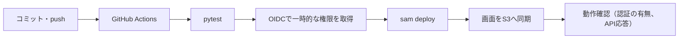

# 検証環境（AWS）のセットアップ手順

mainへのpushで、テスト、デプロイ、動作確認まで自動で行う。この手順は最初に1回だけ必要になる。

## 費用の見込み（月額、推測を含む概算）

| 項目 | 見込み | 根拠 |
| --- | --- | --- |
| Lambda | $0 | 無料枠内。定期処理は月約2,900回、各1秒未満 |
| API Gateway（HTTP API） | $0.01未満 | 100万リクエストあたり約$1 |
| DynamoDB（オンデマンド） | $0.01未満 | 読み書きは月数千回 |
| CloudFront、CloudFront Function | $0 | 無料枠内（転送1TB、リクエスト1,000万、Function 200万回） |
| S3 | $0.01未満 | 画面ファイルは数十KB |
| CloudWatch Logs | $0.1未満 | 保持14日 |
| SSM パラメータ（標準）、EventBridge Scheduler | $0 | 無料 |
| 固定費のあるもの | なし | NAT Gateway、WAF、独自ドメイン（Route 53）、KMSの独自キーは使わない |

AWSの合計は月$0〜1程度。X APIの費用（月約$1〜2）は別である。無料枠が無いアカウントでも、上の表の「$0」は数セント以内に収まる見込みである。

## 手順

### AWS側（1回だけ、約10分）

1. AWSコンソールで東京リージョン（ap-northeast-1）を選ぶ。
2. CloudFormation → スタックの作成 → 新しいリソースを使用 → テンプレートファイルのアップロードで `infra/bootstrap.yaml` を選ぶ。
3. スタック名は `xronix-bootstrap`。パラメータは既定のままでよい。
   - このアカウントに GitHub の OIDC プロバイダーが既にある場合だけ、`CreateOidcProvider` を `false` にする。
4. 「IAMリソースを作成する場合があることを承認」にチェックして作成する。
5. 出力タブの `RoleArn` と `ArtifactBucket` を控える。

### GitHub側（1回だけ）

1. リポジトリの Settings → Environments → New environment で `staging` を作る。
2. Environment variables に次を登録する。
   - `AWS_ROLE_ARN`: 上の `RoleArn`
   - `ARTIFACT_BUCKET`: 上の `ArtifactBucket`
3. Environment secrets に次を登録する。
   - `BASIC_AUTH_USER`: 任意のユーザー名
   - `BASIC_AUTH_PASSWORD`: 20文字以上のランダムな文字列。Basic認証には試行回数の制限が無いため、長くすること
4. 任意: 同じ画面の Required reviewers に自分を入れると、デプロイ前に承認ボタンが出る。

### 初回のデプロイ

1. このブランチを main に取り込む。ワークフローは main にあるものだけが動く。
2. Actions タブの `deploy-staging` が自動で動く。手動で動かす場合は Run workflow を押す。
3. 成功すると、実行結果の要約に「画面のURL」と「Xのコールバック URL」が出る。

### Xの接続

1. Xの開発者コンソールで、専用アプリのコールバックURLに、要約に出た `https://xxxx.cloudfront.net/api/x/callback` を追加する。
2. 画面のURLを開き、Basic認証のユーザー名とパスワードを入力する。
3. 設定で Client ID、コールバックURL（既定で入っている値）、Client Secret を保存し、「Xと接続」を押す。
4. 通知や安全装置（1日の上限は既定で10件）を確認する。定期処理は既定で停止しているので、必要になったら有効にする。

## 以後の運用

| やりたいこと | 方法 |
| --- | --- |
| コードを直して反映する | mainへ取り込む。自動でテストとデプロイが走る |
| 失敗したとき | Actionsのログを見る。CloudFormationは失敗時に自動で元に戻る |
| 画面だけ急いで直す | 同じ（画面もワークフローが配信する） |
| パスワードを変える | GitHubの `BASIC_AUTH_PASSWORD` を更新して、ワークフローを再実行する |
| 止める | 画面の「緊急停止」。または定期処理を無効にする |
| 全部消す | CloudFormationで `xronix-staging` を削除する。S3は空にしてから。SSMの `/xronix/*` は手動で削除する |

## 注意

- OIDCトークンの `sub` は、このリポジトリではIDを含む形式（`repo:Mega-Takoyaki@22055197/xronix@1415292133:environment:staging`）だった。`infra/bootstrap.yaml` のパラメータ `GitHubSubject` で指定する。通常の形式（`repo:組織/リポジトリ:environment:...`）を前提にすると、`Not authorized to perform sts:AssumeRoleWithWebIdentity` で失敗する。
- Basic認証の資格情報のハッシュは、CloudFormationのパラメータ（値は伏せる）と、CloudFront FunctionのコードとLambdaの環境変数に入る。AWSコンソールに入れる人には見える。1人用の検証環境として許容している。
- 認証の強度は、パスワードの長さに依存する。公開して長く運用する段階では、Cognitoなどへ置き換える（ADR-0004）。
- デプロイ用ロールの権限は、スタック名の接頭辞 `xronix-` のIAMロールとS3バケットに絞っているが、Lambda・DynamoDB・CloudFront等はリソースを限定していない。実機では未検証であり、足りない権限があればデプロイ時に拒否される。
